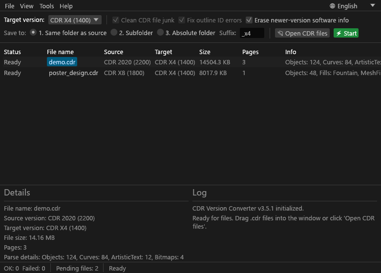

# CDR Version Converter (Trình Chuyển Đổi Phiên Bản CorelDRAW)

[](https://github.com/zmon-bmt/Cdr-version-convert/releases/latest)
[](https://github.com/zmon-bmt/Cdr-version-convert/releases/latest)
[](https://www.rust-lang.org/)
[](https://github.com/emilk/egui)
[](LICENSE)
[]()

> **Tải xuống bản dựng sẵn (Pre-built binary):**  
> 📦 **[Tải file nén ZIP (Khuyên dùng - 4.3 MB)](https://github.com/zmon-bmt/Cdr-version-convert/releases/download/v0.1.0/cdr_converter-v0.1.0-windows-x64.zip)**  
> ⚡ **[Tải file .exe trực tiếp (8.8 MB)](https://github.com/zmon-bmt/Cdr-version-convert/releases/download/v0.1.0/cdr_converter.exe)**  
> 🔗 Xem chi tiết tại [Trang Releases](https://github.com/zmon-bmt/Cdr-version-convert/releases/tag/v0.1.0)

Ứng dụng độc lập (standalone), hiệu năng cao được viết hoàn toàn bằng **Rust** giúp kiểm tra, phân tích và **hạ cấp (downgrade) phiên bản tệp CorelDRAW (`.cdr`)** từ các bản mới (2019, 2020, 2021, 2022) về các bản thấp hơn (X4, X5, X6, X7, X8, 2017, 2018...).

Dự án được xây dựng dựa trên việc dịch ngược và chuẩn hóa cơ chế hoạt động của tiện ích nổi tiếng `CDR convert version 3.5.1.exe` (`CDRFileMgr.exe`), mang lại tốc độ vượt trội, độ an toàn cao cho dữ liệu và trải nghiệm giao diện người dùng hiện đại.

---

## 📸 Giao diện ứng dụng



---

## 🌟 Tính Năng Nổi Bật

- **Không cần cài đặt CorelDRAW**: Xử lý trực tiếp cấu trúc nhị phân của tệp CDR, chạy hoàn toàn độc lập mà không cần bản quyền hoặc phần mềm CorelDRAW trên máy.
- **Tốc độ cực nhanh**: Viết bằng Rust thuần túy, việc phân tích và chuyển đổi mỗi tệp chỉ diễn ra trong vài mili-giây.
- **Hỗ trợ đầy đủ các phiên bản CorelDRAW**:
  - Nhận diện từ **CorelDRAW 11 đến CorelDRAW 2026** (phiên bản `1100` đến `2720+`), tự động phân tích cả XML metadata (`metadata/metadata.xml`, `META-INF/metadata.xml`), FourCC header (`CDRO`, `CDRP`, `CDRQ`, `CDRR`) và luồng chunk `vrsn` RIFF.
  - Hỗ trợ chuyển đổi / hạ cấp mục tiêu linh hoạt: **CorelDRAW X4 (1400), X5 (1500), X6 (1600), X7 (1700), X8 (1800), 2019 (2100), 2020 (2200), 2021 (2300), 2022 (2400), 2024 (2500), 2025 (2600), 2026 (2700)**.
- **Kéo & Thả tiện lợi (Drag and Drop)**: Kéo thả một hoặc nhiều tệp `.cdr` trực tiếp vào cửa sổ để nạp tệp ngay tức thì.
- **Xử lý hàng loạt (Batch Processing)**: Chuyển đổi hàng chục hoặc hàng trăm tệp chỉ với một cú nhấp chuột, chạy trên luồng nền (background thread) không làm đơ giao diện (UI non-blocking).
- **Hỗ trợ Đa Ngôn Ngữ (i18n)**:
  - 🇻🇳 **Tiếng Việt** (Mặc định, chuẩn font có dấu Unicode)
  - 🇬🇧 **English**
  - 🇨🇳 **中文** (Hỗ trợ font CJK: Microsoft YaHei, SimSun...)
  - Tự động ghi nhớ ngôn ngữ đã chọn vào cấu hình máy (`%APPDATA%/CdrVersionConverter/lang.txt`).
- **Tùy chọn lưu tệp linh hoạt**:
  - *Chế độ 1*: Lưu cùng thư mục với tệp gốc (kèm hậu tố tùy chỉnh, ví dụ: `_x4`).
  - *Chế độ 2*: Lưu vào thư mục con chỉ định (ví dụ: `converted/`).
  - *Chế độ 3*: Lưu vào đường dẫn thư mục tuyệt đối tùy chọn.
- **An toàn cho bản vẽ & Dữ liệu vector**:
  - Chỉ can thiệp vào header FourCC, chunk `vrsn` trong luồng RIFF và metadata XML (`metadata/metadata.xml`).
  - Loại bỏ các thẻ thông tin phần mềm bản cao gây lỗi khi mở trên máy bản cũ (`cdrinfo:CurveInfo`, `cdrinfo:ColorInfo`, `inClr:`, `inCrv:`, `inEff:`...).
  - Dữ liệu vector, hình học và màu sắc của bản vẽ được bảo toàn nguyên vẹn.
- **Xem thông tin chi tiết & Nhật ký (Live Log)**:
  - Hiển thị số trang (`NumPages`), dung lượng tệp, phiên bản nguồn, phiên bản đích và chi tiết phân tích.
  - Bảng nhật ký thời gian thực theo dõi quá trình nạp và chuyển đổi từng tệp.

---

## 🔬 Cơ Chế Kỹ Thuật (Mechanics & Specifications)

### 1. Định dạng tệp CorelDRAW
Tệp CorelDRAW tồn tại ở 2 định dạng chính trong lịch sử:
1. **Legacy RIFF (Trước CorelDRAW X4)**:
   - File nhị phân thuần theo cấu trúc Resource Interchange File Format (RIFF).
   - Bắt đầu với magic bytes `RIFF` (`0x46464952`).
2. **ZIP Package Container (Từ CorelDRAW X4 trở đi)**:
   - File thực chất là một gói nén ZIP (magic bytes `PK\x03\x04`).
   - Cấu trúc thư mục bên trong bao gồm:
     - `metadata/metadata.xml`: Chứa metadata tài liệu, thẻ `<cdr:CoreVersion>` và `<AppVersion>`.
     - `content/riffData.dat` (hoặc `content/root.dat`, `root.dat`): Luồng dữ liệu vector RIFF chứa chunk `vrsn`.

### 2. Bảng tham chiếu phiên bản CorelDRAW

| Tên Phiên Bản | Mã Nội Bộ | Giá Trị Hex | FourCC Header |
|---|---|---|---|
| CorelDRAW 11 | 1100 | `0x044C` | - |
| CorelDRAW 12 | 1200 | `0x04B0` | - |
| CorelDRAW X3 | 1300 | `0x0514` | - |
| CorelDRAW X4 | 1400 | `0x0578` | `CDRE` |
| CorelDRAW X5 | 1500 | `0x05DC` | `CDRF` |
| CorelDRAW X6 | 1600 | `0x0640` | `CDRG` |
| CorelDRAW X7 | 1700 | `0x06A4` | `CDRH` |
| CorelDRAW X8 | 1800 | `0x0708` | `CDRI` |
| CorelDRAW 2017 | 1900 | `0x076C` | - |
| CorelDRAW 2018 | 2000 | `0x07D0` | - |
| CorelDRAW 2019 | 2100 | `0x0834` | `CDRL` |
| CorelDRAW 2020 | 2200 | `0x0898` | `CDRM` |
| CorelDRAW 2021 | 2300 | `0x08FC` | `CDRN` |
| CorelDRAW 2022 | 2400 | `0x0960` | `CDRO` |
| CorelDRAW 2023 | 2450 | `0x0992` | `CDRO` |
| CorelDRAW 2024 | 2500 | `0x09C4` | `CDRP` |
| CorelDRAW 2025 | 2600 | `0x0A28` | `CDRQ` |
| CorelDRAW 2026 | 2700 / 2720 | `0x0A8C` | `CDRR` |

### 3. Quy tắc nhận diện & ghi đè chunk `vrsn`
Trong chunk FourCC `vrsn` (`0x6E737276`):
- Đọc giá trị 16-bit word (`u16`).
- Nếu giá trị là `0xFFFF`: Bỏ qua 6 byte tiếp theo và đọc 2 byte sau đó để lấy phiên bản thực tế (`v_real`).
- Nếu giá trị khác `0xFFFF`: Giá trị đó chính là số phiên bản.
- Khi chuyển đổi: Ghi đè giá trị phiên bản mục tiêu (`target_num`) tương ứng vào vị trí 16-bit word thích hợp và cập nhật FourCC header của RIFF.

---

## 📂 Cấu Trúc Dự Án

```text
app/
├── Cargo.toml          # Khai báo cấu hình dự án Rust và các thư viện phụ thuộc
├── Cargo.lock          # Khóa phiên bản dependency cố định
├── build.rs            # Build script đóng gói icon và metadata vào file .exe Windows
├── cdr_conv_icon.ico   # Biểu tượng của ứng dụng
├── MECHANICS.md        # Tài liệu chi tiết kết quả dịch ngược từ bản binary gốc
├── mechanics.json      # Bảng hằng số và cấu trúc FourCC dùng cho verification
├── shots/              # Hình ảnh chụp màn hình ứng dụng
│   ├── now.png
│   └── test.png
└── src/
    ├── main.rs         # Điểm khởi chạy, logic phân tích RIFF/ZIP, thuật toán chuyển đổi, GUI egui
    └── i18n.rs         # Hệ thống đa ngôn ngữ (Tiếng Việt, English, 中文) & cấu hình lưu trữ
```

---

## 🛠️ Yêu Cầu & Hướng Dẫn Cài Đặt

### 1. Yêu cầu môi trường
- Hệ điều hành: Windows 10/11 (khuyến nghị), Linux hoặc macOS.
- **Rust Toolchain**: Bản `stable` (Rust 1.75+ trở lên kèm `cargo`). Cài đặt nhanh tại [rustup.rs](https://rustup.rs/).

### 2. Biên dịch mã nguồn

Clone dự án hoặc chuyển vào thư mục `app`:
```bash
cd app
```

Kiểm tra cú pháp và build thử nghiệm (Debug):
```bash
cargo build
```

Biên dịch bản tối ưu (Release) để sử dụng:
```bash
cargo build --release
```
File thực thi độc lập sẽ được tạo tại:
```text
target/release/cdr_converter.exe
```
*(Bạn có thể copy file `.exe` này đi bất cứ máy tính Windows nào để chạy trực tiếp mà không cần cài thêm bất kỳ phần mềm nào khác).*

### 3. Khởi chạy ứng dụng
Chạy trực tiếp qua Cargo:
```bash
cargo run
```
Hoặc mở trực tiếp file `cdr_converter.exe`.

Hỗ trợ tham số dòng lệnh kiểm thử giao diện:
```bash
cargo run -- --screenshot output.png
```

---

## 📖 Hướng Dẫn Sử Dụng

1. **Khởi động ứng dụng**: Chạy file `cdr_converter.exe`. Giao diện mặc định là **Tiếng Việt**.
2. **Chọn ngôn ngữ (Tùy chọn)**: Nếu muốn đổi ngôn ngữ, bấm vào nút 🌐 ở góc trên bên phải hoặc vào menu `Cài đặt` -> `Ngôn ngữ` để chọn **Tiếng Việt**, **English** hoặc **中文**.
3. **Thêm tệp cần chuyển đổi**:
   - Cách 1: **Kéo & thả** các file `.cdr` từ File Explorer vào cửa sổ ứng dụng.
   - Cách 2: Bấm nút **📂 Mở tệp CDR** hoặc menu `Tệp` -> `Mở...` (`Ctrl + O`) để chọn tệp.
4. **Cấu hình tùy chọn chuyển đổi**:
   - **Phiên bản đích**: Chọn phiên bản muốn hạ cấp xuống (mặc định là `CDR X4 (1400)` - phiên bản phổ biến nhất trong các xưởng in).
   - **Vị trí lưu**:
     - *Cùng thư mục gốc*: Tệp kết quả lưu cạnh tệp nguồn, được thêm hậu tố (mặc định: `_x4`).
     - *Thư mục con*: Lưu vào thư mục con (mặc định: `converted/`).
     - *Thư mục tuyệt đối*: Chỉ định đường dẫn thư mục tùy thích.
   - **Xóa thông tin phần mềm bản cao**: Khuyên bật (mặc định đã chọn) để tránh lỗi không tương thích.
5. **Tiến hành chuyển đổi**:
   - Bấm nút xanh **⚡ Bắt đầu xử lý**.
   - Trạng thái từng tệp sẽ được cập nhật: `✓ Thành công` (xanh) hoặc `✕ Thất bại` (đỏ).
   - Xem chi tiết quá trình tại bảng **Nhật ký** ở nửa dưới màn hình.

---

## 📋 Thư Viện Sử Dụng (Dependencies)

- [`egui`](https://crates.io/crates/egui) & [`eframe`](https://crates.io/crates/eframe) (v0.36.2): Framework giao diện người dùng GUI tức thì (immediate mode GUI) cực nhẹ và mượt mà cho Rust.
- [`zip`](https://crates.io/crates/zip) (v3.0.0): Đọc và giải nén / đóng gói container ZIP với chuẩn nén Deflate.
- [`image`](https://crates.io/crates/image) (v0.25.10): Xử lý xuất và lưu ảnh chụp màn hình kiểm thử.
- [`rfd`](https://crates.io/crates/rfd) (v0.17.2): Rust File Dialog - hiển thị hộp thoại chọn tệp chuẩn Native của hệ điều hành.

---

## 🤝 Đóng Góp & Phát Triển (Contributing)

Mọi đóng góp, báo cáo lỗi hoặc đề xuất tính năng mới đều được hoan nghênh:
1. Fork dự án.
2. Tạo nhánh tính năng mới (`git checkout -b feature/tinh-nang-moi`).
3. Commit thay đổi (`git commit -m 'Thêm tính năng...'`).
4. Push lên nhánh của bạn (`git push origin feature/tinh-nang-moi`).
5. Tạo một **Pull Request**.

---

## 📄 Bản Quyền & Miễn Trừ Trách Nhiệm (Disclaimer & License)

- Dự án này được phân phối dưới giấy phép mã nguồn mở.
- **CorelDRAW** là thương hiệu đã đăng ký của Corel Corporation. Dự án này là công cụ độc lập phát triển nhằm mục đích tương thích định dạng tệp và nghiên cứu kỹ thuật, không có liên kết chính thức với Corel Corporation.
